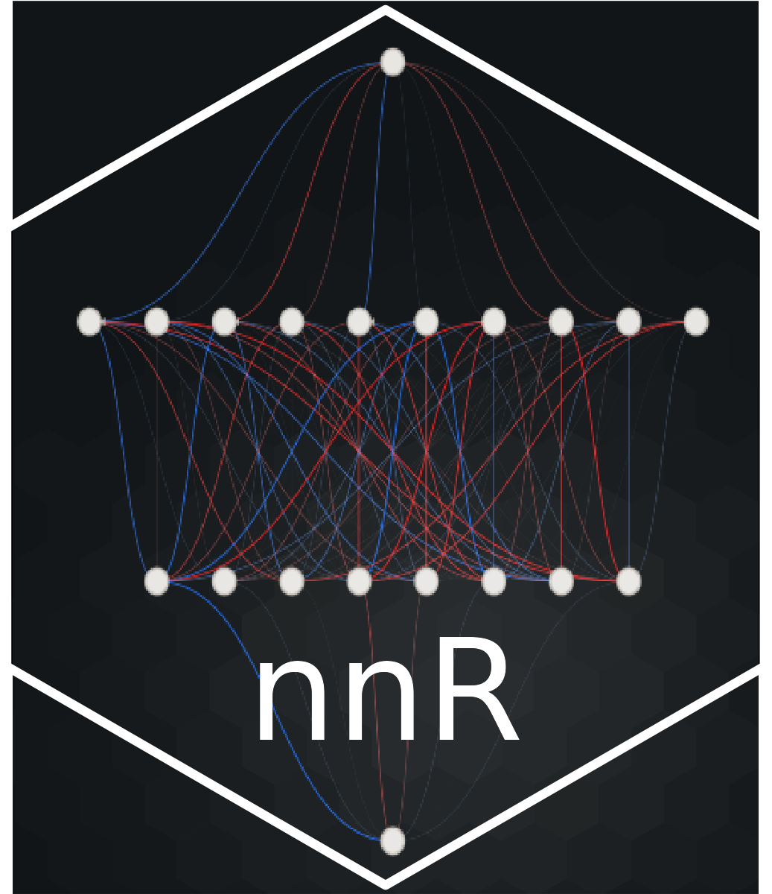

[](https://zenodo.org/badge/latestdoi/752787458)



# nnR: Neural Networks Made Algebraic

nnR is an R package for doing arithmetic on neural networks. A network is stored as a list of `(W, b)` pairs, one weight matrix and one bias vector per layer, and the package provides functions that combine such networks into new networks: composing, stacking, adding, multiplying, and so on. The result of each operation is itself a network that can be evaluated with a ReLU activation.

The practical point is that some functions, such as squares, products, powers, exponentials, sine and cosine, can be approximated by an explicitly constructed ReLU network whose size and accuracy are known in advance. Building these networks by hand is tedious; nnR does it for you.

The operations follow the construction in [Rafi, Padgett, and Nakarmi (2024)](https://doi.org/10.48550/arXiv.2402.01058), which adapts earlier work by [Grohs et al. (2023)](https://doi.org/10.1007/s10444-022-09970-2) and [Jentzen, Kuckuck, and von Wurstemberger (2023)](https://doi.org/10.48550/arXiv.2310.20360). Definition numbers below refer to the first paper.

## Installation

```r
install.packages("remotes")
remotes::install_github("2shakilrafi/nnR")
library(nnR)
```

nnR needs R 4.1 or newer.

## A short example

```r
library(nnR)

# A random network with layer widths 1 -> 3 -> 5 -> 6
nn <- create_nn(c(1, 3, 5, 6))

# Evaluate it at x = 8 with a ReLU activation
inst(nn, ReLU, 8)
```

The vignette (`vignette("nnR")`) walks through each operation with examples.

## What the package implements

| Operation | Definition |
|---|---|
| Composition of two networks | 2.6 |
| Stacking networks side by side | 2.14 |
| Sum of networks | 2.19 |
| Squares and products | 2.24, 2.25 |
| Powers | 2.26 |
| Exponential, sine, cosine | 2.28, 2.29, 2.30 |
| One-dimensional trapezoidal rule | 2.31, 2.33 |
| Norms, maxima, and a max-convolution approximation of continuous functions on an interval | 2.35, 2.37, 2.39 |

## Scope

This is a reference implementation intended for teaching and for checking the mathematics. It has not been optimized for speed, so benchmark it before using it on anything performance-sensitive.

## Development

From a source checkout:

```r
devtools::test()              # run the test suite
devtools::build_vignettes()   # build the vignette
```

## Citing

If you use nnR, please cite the paper above and the software record on Zenodo (DOI 10.5281/zenodo.10672209). `CITATION.cff` has the details.

## License

GPL-3
